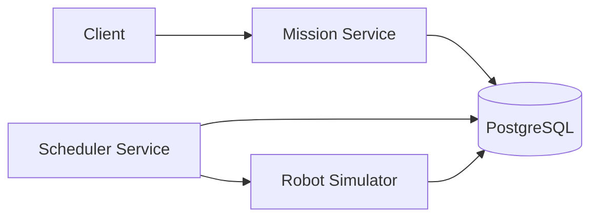

# Architecture

The system is a small distributed mission platform composed of a PostgreSQL
state store and three runtime services:

## Service boundaries

| Component | Responsibility | Local instances | State location |
|---|---|---:|---|
| Mission Service | Accept and read missions | 1 | PostgreSQL |
| Scheduler Service | Claim queued missions and reserve robots | 1 | PostgreSQL locks and rows |
| Robot Simulator | Execute missions and write telemetry | 1 | PostgreSQL |
| PostgreSQL | Durable source of truth | 1 | Named Docker volume |

The repository contains a placeholder for a future Robot Status Service. The
current implementation keeps robot status in PostgreSQL and exposes it through
the mission workflow; the placeholder is not counted as a running service.

## Request flow

1. The Mission Service inserts a mission with status `QUEUED`.
2. A Scheduler Service instance claims one queued mission using
   `FOR UPDATE SKIP LOCKED`, selects an available robot, and commits both
   updates in one transaction.
3. The scheduler asks the Robot Simulator to execute the mission.
4. The simulator writes telemetry, marks the mission `COMPLETED`, and releases
   the robot.

## Design decision

The database is the consistency boundary. Service processes are intentionally
replaceable; mission and robot state are not kept only in process memory.
This makes horizontal scaling possible, but also makes PostgreSQL the primary
scaling bottleneck and a single point of failure in the current checkpoint
implementation.

See [design-review.md](design-review.md) for instance counts, failure impact,
scaling limits, data ownership, and cost analysis.
